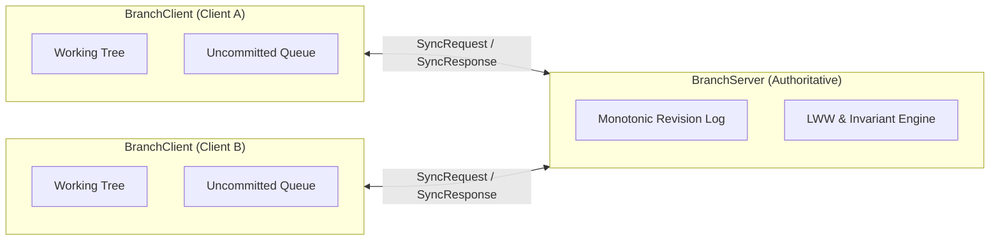

# Offline-First Mindmap Synchronization Algorithm

A deterministic, offline-first synchronization algorithm for mindmaps built in TypeScript using Test-Driven Development (TDD).

Clients can operate offline indefinitely, modifying node content, inserting new subtopics, reordering siblings, moving subtrees, and deleting nodes. When reconnecting to the server, clients perform a bidirectional sync session that reconciles concurrent edits deterministically without central wall clocks or full-document locks.

---

## 🌟 Key Capabilities

- **Branch-as-a-Unit Synchronization**: Mindmaps synchronize one branch subtree at a time, keeping payload sizes small, conflicts localized, and mobile connections efficient (see [ADR 0001](docs/adr/0001-branch-level-sync.md)).
- **Deterministic Causal Ordering (Lamport Logical Clocks)**: Physical wall clocks are ignored in favor of Lamport timestamps paired with client identifiers as a total ordering tie-breaker (`(lamportTime, clientId)`).
- **Collision-Free Sibling Ordering (Fractional Indexing)**: Siblings are positioned using lexicographic fractional rank strings (e.g. `"a0"`, `"a1"`, `"a0V"`), allowing unbounded concurrent insertions between siblings without index collisions or renumbering cascades.
- **Tree Cycle Prevention**: The server detects parentage inversions during concurrent moves (e.g. Client A moves X under Y while Client B moves Y under X) and rejects cycle-inducing operations to preserve acyclic tree integrity.
- **User Work Preservation (Orphan Recovery)**: If a client creates a new child node under a parent that was concurrently deleted by another client, the server reparents the new child to the branch root rather than discarding it.
- **Sticky Tombstones**: Deleted nodes receive persistent tombstones that prevent accidental resurrection by concurrent offline edits.
- **Optimistic Client Rebase**: Local edits apply immediately to the working tree; upon sync, accepted operations are cleared and the working tree rebases over the authoritative server state.
- **Pure In-Memory Determinism**: Sub-millisecond execution with zero sleeps, timers, or network/database dependencies.

---

## 🏗️ Architecture & Seams

The algorithm is structured around three public testing seams:



1. **Client Seam (`BranchClient`)**: Manages local working state, uncommitted mutation queues, Lamport clocks, sibling ranking, and optimistic state rebasing.
2. **Server Seam (`BranchServer`)**: Authoritative revision increments, conflict resolution, sticky tombstone enforcement, ancestor cycle rejection, and differential history delivery.
3. **Collaborative Seam (Multi-Client Simulation)**: Simulates distributed offline divergence and deterministic convergence across multiple clients.

---

## 📖 Domain Language

This project uses strict ubiquitous language defined in [`GLOSSARY.md`](GLOSSARY.md):

- **Mindmap**: Hierarchical document organized around a central root node.
- **Branch**: An independent subtree attached to the central root node, serving as the unit of synchronization.
- **Node**: A single topic possessing an ID, content, parent reference, and sibling order key.
- **Operation**: An immutable record (`create_node`, `update_content`, `move_node`, `delete_node`) tagged with Lamport metadata.
- **Revision**: Monotonically increasing authoritative integer on the server.
- **Tombstone**: Marker recording node deletion to prevent resurrection.
- **Orphan Node**: A node whose parent was concurrently deleted, recovered by reparenting to the branch root.

---

## 🚀 Quick Start

### Prerequisites
- Node.js 20+ (developed on Node 26)
- npm 10+

### Installation
```bash
npm install
```

### Running Tests
Execute the unit and end-to-end test suites:
```bash
npm test
```

### Running the Interactive 3-Panel Visualizer
Launch the interactive web simulation with three side-by-side offline clients:
```bash
npm run dev
```
Open `http://localhost:5173` in your browser.

### Watch Mode
```bash
npm run test:watch
```

### Type Checking & Production Build
```bash
npx tsc --noEmit
npm run build
```

---

## 💻 Code Example

```typescript
import { BranchClient } from './src/branch-client.js';
import { BranchServer } from './src/branch-server.js';

// 1. Initialize server and two clients
const server = new BranchServer();
const branchId = 'roadmap-branch';
const rootId = 'roadmap-root';

const clientA = new BranchClient({ clientId: 'alice', branchId, branchRootId: rootId });
const clientB = new BranchClient({ clientId: 'bob', branchId, branchRootId: rootId });

// 2. Alice creates initial topic and syncs
const featureNode = clientA.createNode({ parentId: rootId, content: 'User Authentication' });
clientA.applySyncResponse(server.sync(clientA.prepareSync(), rootId));

// 3. Bob syncs to get current state
clientB.applySyncResponse(server.sync(clientB.prepareSync(), rootId));

// 4. Both clients go offline and make concurrent edits
clientA.updateNode(featureNode.id, 'OAuth2 & Passkeys');
clientA.createNode({ parentId: featureNode.id, content: 'Google Sign-in' });

clientB.updateNode(featureNode.id, 'OAuth2 & Magic Links');
clientB.createNode({ parentId: featureNode.id, content: 'GitHub Sign-in' });

// 5. Reconnect and sync
clientA.applySyncResponse(server.sync(clientA.prepareSync(), rootId));
clientB.applySyncResponse(server.sync(clientB.prepareSync(), rootId));
clientA.applySyncResponse(server.sync(clientA.prepareSync(), rootId));

// 6. Both clients converge to identical trees deterministically
console.log(clientA.getChildren(featureNode.id));
console.log(clientB.getChildren(featureNode.id));
```

---

## 📁 Repository Structure

```
├── GLOSSARY.md             # Canonical ubiquitous domain vocabulary
├── index.html              # 3-Panel interactive mindmap visualizer UI
├── docs/
│   ├── adr/
│   │   └── 0001-branch-level-sync.md  # Architecture Decision Record
│   └── editable_mindmap_ui_plan.md    # Web visualizer implementation plan
├── src/
│   ├── types.ts            # Node, Tree, Operation, and Sync contracts
│   ├── fractional-index.ts # Lexicographical rank string generator
│   ├── random-title.ts     # Generates random [Adjective] [Noun] titles
│   ├── branch-client.ts    # Client-side offline engine & working tree
│   ├── branch-server.ts    # Server-side authoritative sync engine
│   ├── simulated-network.ts # In-memory network & online/offline toggling
│   └── ui/
│       ├── app.ts          # Multi-client DOM rendering & sync coordinator
│       └── styles.css      # 3-column dashboard styles
└── tests/
    ├── branch-client.test.ts # Client unit tests
    ├── branch-server.test.ts # Server unit tests
    ├── e2e-sync.test.ts      # Multi-client offline collaboration tests
    ├── random-title.test.ts  # Title generator unit tests
    └── simulated-network.test.ts # Network isolation & online/offline tests
```
