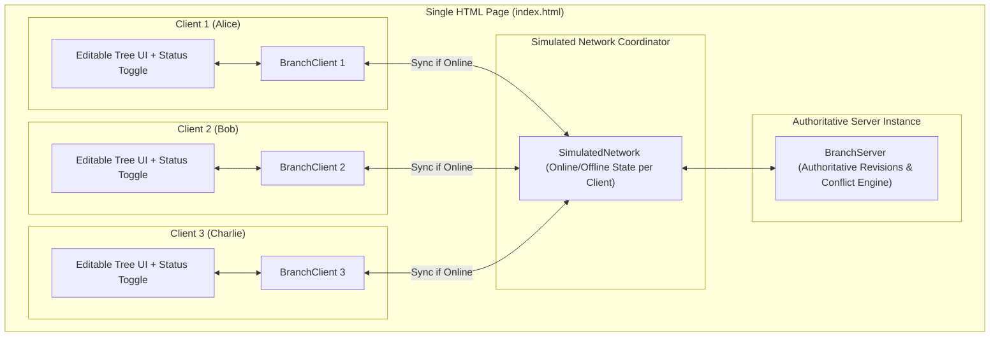

# Implementation Plan: 3-Panel Side-by-Side Editable Mindmap with Offline Toggles

Build an interactive web-based visualizer for the offline sync algorithm featuring three side-by-side client panels (Client 1, Client 2, Client 3) on a single HTML page. Each client has an independent **Online/Offline toggle** to demonstrate offline editing, concurrent divergence, and deterministic convergence.

---

## User Review Required

> [!IMPORTANT]
> **Simulated In-Browser Network**: All three clients and the central server run inside the browser runtime in pure in-memory JavaScript/TypeScript. When a client is toggled "Offline", its network requests are intercepted and blocked locally. When toggled "Online", it reconnects and synchronizes against the shared `BranchServer`. This eliminates backend hosting setup while delivering sub-millisecond offline simulation.

> [!NOTE]
> **Vite Bundler**: We will add `vite` as a dev dependency so TypeScript runs directly with hot-reloading at `http://localhost:5173`.

---

## Open Questions

None currently. The requirements are clear: three side-by-side client panels on one HTML page with independent online/offline toggles and full node editing capabilities.

---

## Architecture Overview



---

## Proposed Changes

### 1. Tooling & Dependencies

#### [MODIFY] [`package.json`](../package.json)
- Add `vite` to `devDependencies`.
- Add `"dev": "vite"` and `"build": "vite build"` scripts.

---

### 2. Network Simulation Layer

#### [NEW] [`src/simulated-network.ts`](../src/simulated-network.ts)
A thin network mediation layer coordinating client-server communication:
- Tracks connection status (`isOnline: boolean`) per client.
- `setClientOnline(clientId: string, online: boolean)`: Toggles connection state.
- `syncClient(client: BranchClient)`:
  - If client is offline, returns `{ success: false, reason: 'offline' }`.
  - If online, executes `server.sync(client.prepareSync())` and calls `client.applySyncResponse(res)`.
  - Notifies registered listeners so other online clients can optionally auto-sync.

---

### 3. Web UI & Application

#### [NEW] [`index.html`](../index.html)
- Responsive multi-column layout with 3 side-by-side client panels.
- Global header with mindmap branch selector and "Sync All Online" shortcut.
- Client panels:
  - **Panel Header**: Client name, Connection Toggle switch (Online/Offline) with visual indicator LED, "Sync Now" button, and badge displaying pending uncommitted operations count.
  - **Tree View Canvas**: Hierarchical tree layout rendering the root node and all child topics.
  - **Node Actions**:
    - Inline editable title (click/type to edit).
    - `+ Subtopic` button (adds child).
    - `+ Sibling` button (adds sibling with fractional indexing).
    - `✕` button (tombstones node).
    - `Move` dropdown (reparents node to any non-descendant node).
  - **Activity Log Drawer**: Displays recent operations, sync events, and conflict resolutions.

#### [NEW] [`src/ui/styles.css`](../src/ui/styles.css)
- Clean, modern dashboard styles.
- 3 side-by-side columns with independent scroll containers.
- Distinct color accents for each client (Blue for Client 1, Purple for Client 2, Emerald for Client 3).
- Offline banner / dimmed state when a client is offline to give clear visual feedback.

#### [NEW] [`src/ui/app.ts`](../src/ui/app.ts)
- Mounts and manages the three `BranchClient` instances and the shared `BranchServer`.
- Implements tree rendering with DOM event delegation for editing, adding, moving, and deleting nodes.
- Synchronizes UI state when edits occur or sync responses arrive.

---

## Verification Plan

### Automated Tests
Run unit tests for the network simulation layer and existing domain engines:
```bash
npm test
```
Verify strict TypeScript compilation:
```bash
npx tsc --noEmit
```

### Manual Verification
1. Launch the dev server:
   ```bash
   npm run dev
   ```
2. Open the browser to `http://localhost:5173`.
3. **Verify Baseline Sync**:
   - In Client 1, add a child node "Marketing Campaign".
   - Notice it instantly shows up in Client 2 and Client 3 (since all are online).
4. **Verify Offline Isolation**:
   - Toggle **Client 2 to Offline**.
   - In Client 2, edit "Marketing Campaign" to "Marketing Campaign (Draft 2026)" and add "Twitter Launch".
   - Notice: Client 1 and Client 3 do NOT see Client 2's edits. Client 2 shows "2 uncommitted operations".
5. **Verify Concurrent Divergence**:
   - While Client 2 is still offline, edit "Marketing Campaign" in Client 1 to "Marketing Campaign (Approved)".
   - Client 3 immediately receives Client 1's update.
6. **Verify Reconnect & Convergence**:
   - Toggle **Client 2 to Online**.
   - Client 2 immediately syncs:
     - Its local Lamport clock and operations resolve deterministically.
     - "Twitter Launch" appears across all three panels.
     - Content converges across Client 1, Client 2, and Client 3.
